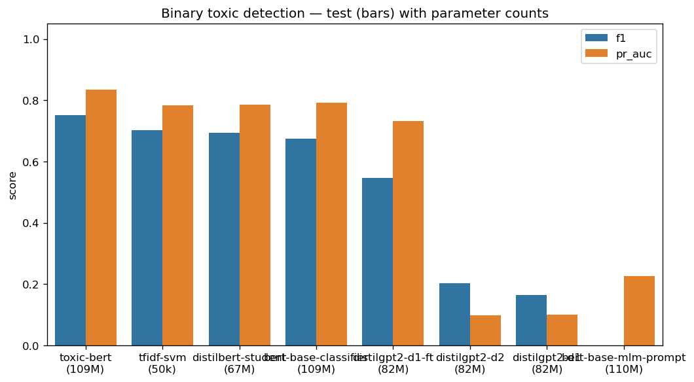
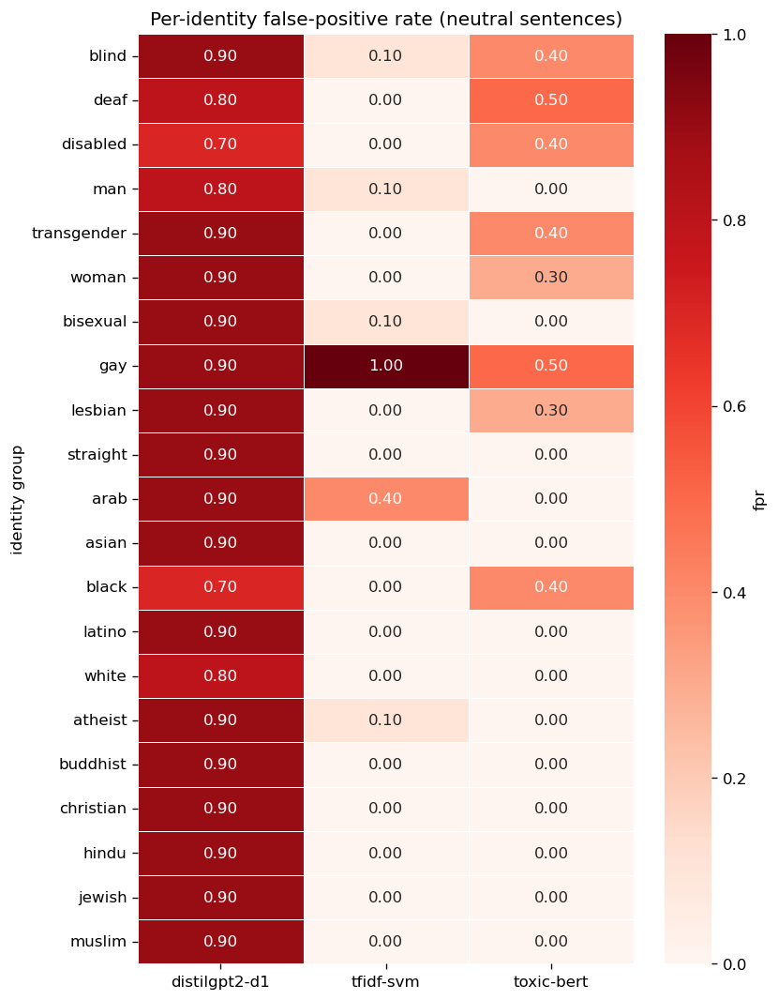
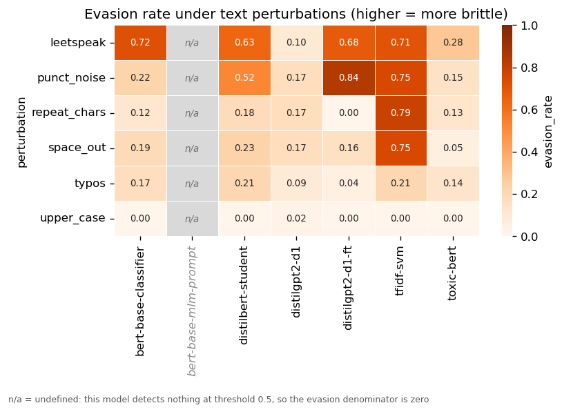
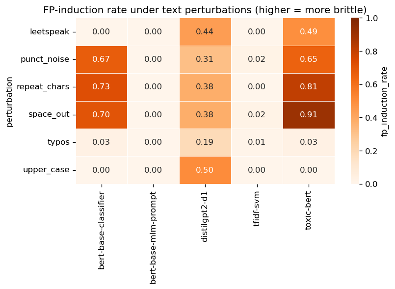

# Words That Harm — Architectures, Robustness and Fairness in Toxic-Comment Detection

Technion **EE046211 Deep Learning** course project.
Authors: **Omer Ramon**, **Tom Jacob**. Supervisor: Roy.

A controlled **audit** of toxic-comment detectors on the Jigsaw 2018 dataset. The
question is not "which model has the best F1" but **which kind of error each model
makes, and why**. A false negative is a *safety* failure ("Shut up you m0r0n" reaches
its target); a false positive is a *fairness* failure ("I am a gay man and I edited
this page" is removed as abuse). Eight configurations from four families are scored
through one interface, on one seeded test subset, on the same hardware, and then
put through three probes (accuracy vs. cost, an identity-fairness probe, and a
two-direction perturbation suite) plus a masking intervention.

> **Runs on CPU by default — no GPU required.** A GPU is used automatically if one
> works on your machine (see §7).

---

## Contents

1. [The models](#1-the-models)
2. [Hypotheses](#2-hypotheses)
3. [Results](#3-results)
4. [Quick start](#4-quick-start)
5. [Reproducing every number](#5-reproducing-every-number)
6. [How the code is organized](#6-how-the-code-is-organized)
7. [Environment notes (CPU vs. GPU)](#7-environment-notes-cpu-vs-gpu)
8. [Changes from the proposal](#8-changes-from-the-proposal)
9. [References and credits](#9-references-and-credits)

---

## 1. The models

Every model is reduced to a single scalar **`P(toxic)`** in `[0, 1]` and binarised at
0.5, so all eight are directly comparable regardless of architecture.

| ID | Model | Family | Params | Mechanism | Who trained it |
|---|---|---|---|---|---|
| **E2** | `toxic-bert` | BERT encoder | 109M | Pretrain + fine-tune on full Jigsaw, 6 sigmoid heads ([`unitary/toxic-bert`](https://huggingface.co/unitary/toxic-bert), Detoxify) | Unitary (third party) |
| **E1** | `bert-base-classifier` | BERT encoder | 109M | [`bert-base-uncased`](https://huggingface.co/bert-base-uncased) + new 2-way classification head (softmax over toxic / non-toxic, equivalent to one sigmoid on the logit difference), class-weighted cross-entropy, 12k rows on CPU | **Us** |
| **E1-p** | `bert-base-mlm-prompt` | BERT encoder (0-shot) | 109M | The *same* `bert-base-uncased`, read through its pretrained masked-LM head; nothing trained | — |
| **E0** | `tfidf-svm` | Non-neural | ~50k | TF-IDF uni+bigrams + Platt-calibrated `LinearSVC` | **Us** (fits in seconds) |
| **D1** | `distilgpt2-d1` | GPT-2 decoder (0-shot) | 82M | [`distilgpt2`](https://huggingface.co/distilgpt2), yes/no prompt, log-prob comparison | — |
| **D2** | `distilgpt2-d2` | GPT-2 decoder (0-shot) | 82M | Same weights, fill-in-blank prompt | — |
| **D1-ft** | `distilgpt2-d1-ft` | GPT-2 decoder | 82M | D1 fine-tuned on the answer token (Colab 20k×4 ep.; local 800×2 ep.) | **Us** |
| **S1** | `distilbert-student` | DistilBERT | 67M | Soft KD from E2, T = 2, α = 0.7 (Colab 20k×4 ep.; local 4k×2 ep.) | **Us** |

Unless marked "Colab", every number below comes from the **local** checkpoints.

**Why this roster.** The comparison is built from controlled pairs, not a leaderboard:

- **E1 vs. E1-p**: identical pretrained weights, a trained head vs. zero-shot prompting.
  The read-out method is the only variable.
- **E1 vs. E2**: identical architecture; only the scale of supervised fine-tuning differs.
- **E0 vs. everything**: whatever E0 achieves needs no contextual understanding at all.
- **D1 vs. D2**: same decoder, different prompt wording, which measures prompt sensitivity.
- **D1 vs. D1-ft**: separates "decoders can't do this" from "this decoder was never told what to do".
- **E2 vs. S1**: does compression amplify bias?

**Dataset.** [Jigsaw Toxic Comment Classification Challenge](https://www.kaggle.com/c/jigsaw-toxic-comment-classification-challenge)
(Kaggle, 2018): Wikipedia talk-page comments with six binary labels. The target is
`toxic`; all six labels are kept for distillation. `train.csv` is split 85/15
(**135,635 train / 23,936 val**) and the labeled rows of `test.csv` (**63,978**) form
the test set.

---

## 2. Hypotheses

- **H1.** Identity bias is learned from labeled task data, so the specialized encoder
  over-flags neutral identity mentions more than a non-neural baseline trained on the
  same data.
- **H2.** Distillation preserves the teacher's accuracy but amplifies its identity bias.
- **H3.** A trained discriminative head beats zero-shot prompting at this scale,
  whether the network is an encoder or a decoder.

---

## 3. Results

### 3.1 Accuracy versus efficiency (shared n = 800 test subset, CPU)

Accuracy is deliberately **not** reported: at ~10% positives an all-negative
classifier scores 90%.

| Model | Params | F1 | PR-AUC | ROC-AUC | ms/comment |
|---|---|---|---|---|---|
| `toxic-bert` (E2) | 109M | **0.752** | **0.835** | **0.979** | 175 |
| `tfidf-svm` (E0) | 50k | 0.703 | 0.784 | 0.958 | **0.1** |
| `distilbert-student` (S1) | 67M | 0.695 | 0.786 | 0.966 | 263 |
| `bert-base-classifier` (E1) | 109M | 0.675 | 0.791 | 0.961 | 278 |
| `distilgpt2-d1-ft` | 82M | 0.546 | 0.732 | 0.961 | † |
| `distilgpt2-d2` (0-shot) | 82M | 0.202 | 0.098 | 0.457 | 645 |
| `distilgpt2-d1` (0-shot) | 82M | 0.163 | 0.100 | 0.389 | 649 |
| `bert-base-mlm-prompt` (E1-p) | 109M | 0.000\* | 0.227 | 0.722 | 283 |

\* A calibration artefact, not a discrimination failure: E1-p's scores almost never
cross 0.5, yet it ranks far better than the zero-shot decoders.
† Timing window corrupted by a machine suspend; D1-ft shares D1's scoring path, so expect ≈650 ms.
With fewer than 100 positives in the subset, F1 gaps below ~0.05 are within sampling noise.



### 3.2 Fairness: identity false-positive rate (368 neutral sentences)

16 neutral templates × 23 fillers (21 identity terms + `human`, `normal`). Nothing is
toxic, so every positive is a false positive. A length-matched control set has no
identity term.

| Model | Identity FPR | 95% CI (Wilson) | FPR after inference masking | Control FPR |
|---|---|---|---|---|
| `distilbert-student` (S1) | **0.008** | [0.003, 0.024] | 0.000 | 0.000 |
| `tfidf-svm` (E0) | 0.049 | [0.031, 0.076] | 0.000 | 0.000 |
| `toxic-bert` (E2) | 0.087 | [0.062, 0.120] | 0.000 | 0.000 |
| `bert-base-classifier` (E1) | 0.103 | [0.076, 0.139] | **0.188** | 0.000 |
| `distilgpt2-d1-ft` | 0.326 | [0.281, 0.375] | – | 0.000 |
| `distilgpt2-d1` | 0.899 | [0.864, 0.926] | – | 1.000 |
| `distilgpt2-d2` | 1.000 | [0.990, 1.000] | – | 1.000 |
| `bert-base-mlm-prompt` (E1-p) | 0.000\* | [0.000, 0.010] | 0.000 | 0.000 |

\* Not fairness: E1-p almost never crosses 0.5 at all.



### 3.3 Robustness, measured in both directions

- **Evasion rate**: fraction of already-detected toxic comments pushed below 0.5 (n = 100; n = 25 for D1-ft).
- **FP-induction rate**: fraction of correctly-classified neutral comments pushed above 0.5.

| Evasion (higher = more brittle) | leetspeak | space-out | punct-noise |
|---|---|---|---|
| `toxic-bert` (E2) | **0.280** | **0.054** | **0.150** |
| `bert-base-classifier` (E1) | 0.719 | 0.191 | 0.225 |
| `distilbert-student` (S1) | 0.634 | 0.232 | 0.524 |
| `tfidf-svm` (E0) | 0.711 | 0.750 | 0.750 |

| FP induction (higher = more brittle) | space-out | repeated chars | punct-noise | unperturbed FP rate |
|---|---|---|---|---|
| `toxic-bert` (E2) | 0.910 | 0.809 | 0.652 | 0.110 |
| `distilbert-student` (S1) | 0.707 | 0.793 | 0.239 | 0.080 |
| `tfidf-svm` (E0) | 0.021 | 0.000 | 0.021 | 0.050 |

The model that is hardest to trick into *missing* toxicity is among the easiest to
trick into *manufacturing* it; the SVM is the mirror image.




### 3.4 Masking intervention

- **Inference-time** (identity term → `[MASK]` / empty string): identity FPR collapses
  for `toxic-bert` (0.087 → 0), S1 (0.008 → 0) and the SVM (0.049 → 0), but **rises**
  for E1 (0.103 → 0.188).
- **Training-time** (SVM retrained with identity terms removed): identity FPR does not
  fall (0.049 → 0.063) while `identity_hate` recall drops (0.781 → 0.676), at roughly
  unchanged `toxic` recall (0.659 → 0.645).

### 3.5 Same checkpoint, two methods (E1 vs. E1-p)

The trained head dominates on every metric (F1 0.675 vs. 0.000, PR-AUC 0.791 vs. 0.227,
ROC-AUC 0.961 vs. 0.722). The two agree on 82.8% of comments; accuracy looks
deceptively close (0.908 vs. 0.885) because of the base rate, and in the 138
disagreements E1 consistently catches toxicity that E1-p misses.

### 3.6 Distillation and decoder fine-tuning: Colab vs. local runs

| Checkpoint | Train scale | Eval n | F1 | ROC-AUC | Identity FPR |
|---|---|---|---|---|---|
| `toxic-bert` (teacher) | Unitary, full Jigsaw | 800 | 0.752 | 0.979 | 0.087 |
| `toxic-bert` (teacher) | Unitary, full Jigsaw | 500ᵃ | 0.770 | – | 0.152 |
| S1, Colab | 20k × 4 ep. | 500ᵃ | 0.772 | – | 0.062 |
| S1, ours (early-stopped) | 4k × 2 ep. | 800 | 0.695 | 0.966 | **0.008** |
| D1 (zero-shot) | – | 800 | 0.163 | 0.389 | 0.899 |
| D1 (zero-shot) | – | 200ᵃ | 0.189 | 0.46 | 0.867 |
| D1-ft, Colab | 20k × 4 ep. | 200ᵃ | 0.590 | 0.965 | 0.505 |
| D1-ft, ours (early-stopped) | 800 × 2 ep. | 800 | 0.546 | 0.961 | 0.326 |

ᵃ Separate GPU passes at n = 500 / 200; compare rows only within the same eval n.
Under the Colab protocol the student matches its teacher's F1 at ~1.7× lower latency
(159 vs. 274 ms). Our CPU-only re-run (4k × 2 ep. already took 2 h 31 m) does not
match the teacher's F1, but its identity FPR is an order of magnitude lower.

### 3.7 Conclusions

1. **Toxicity detection is substantially lexical, but not purely so.** A 50k-feature
   linear model reaches ~93% of a 109M encoder's F1 at ~1750× lower latency.
2. **The encoder's evasion robustness is earned, not architectural.** The generic
   `bert-base-classifier`, identical in architecture to `toxic-bert`, is nearly as easy
   to evade as the SVM (leetspeak 0.719 vs. 0.711) and no fairer; both gaps point at
   `toxic-bert`'s training scale.
3. **A discriminative head beats prompting, most cleanly on a single checkpoint**, yet
   BERT's zero-shot prompt still ranks far better than GPT-2's, so architecture and
   method contribute independently (H3 confirmed).
4. **Identity bias is data-driven but not uniform in mechanism.** Masking the identity
   token erases it for `toxic-bert` but increases it for our generic classifier; a
   mitigation validated on one model cannot be assumed to transfer. H1 holds in
   direction but only marginally (0.087 vs. 0.049, Fisher p ≈ 0.06).
5. **Compression preserved fairness but cost robustness**, the opposite on both axes
   of the proposal's question "less fair but more robust?". The student is the fairest
   discriminating model (0.008 vs. its teacher's 0.087) yet more than twice as easy to
   evade (H2 rejected on fairness).
6. **"Robust" is not one property.** `toxic-bert` is the hardest model to evade and
   among the easiest to push into false alarms (65–91% vs. an 11% baseline); the SVM
   is the mirror image.

**Limitations.** Headline numbers use an 800-comment subset so every model, including
the ~650 ms/comment decoders, could be scored under identical CPU conditions; intervals
are reported only for the fairness probe. S1 and D1-ft are early-stopped checkpoints,
so their accuracy is a floor. The perturbation suite uses n = 100 (n = 25 for D1-ft).
The fairness probe is synthetic, and all evaluation is in-domain Wikipedia text.

---

## 4. Quick start

```bash
conda activate deep_learn          # Python 3.8, torch 2.3.0+cu121 (see §7)
pip install -r requirements-project.txt

python scripts/download_jigsaw.py       # dataset  -> data/raw/jigsaw/
python scripts/download_toxic_bert.py   # E2       -> models/toxic-bert/
python scripts/download_distilgpt2.py   # D1/D2    -> cached by transformers
python scripts/make_splits.py           # splits   -> data/processed/split_indices.parquet
```

`download_jigsaw.py` uses Kaggle if credentials are configured, otherwise the
`Heliosoph/Jigsaw-Toxic-Comments` HuggingFace mirror (no account needed).

> **Always set `PYTHONIOENCODING=utf-8`** on Windows. The console is cp1252 and the
> repository path contains Hebrew characters, so `print()`-ing a path crashes without it.

> **Model weights and raw data are gitignored** (hundreds of MB). The small result
> JSONs in `data/processed/` **are** committed, so every number above can be checked
> without re-running anything. To see which models are present locally:
> `python -c "import sys; sys.path.insert(0,'src'); import roster; roster.print_roster_status()"`

---

## 5. Reproducing every number

### 5.1 Train the models we train ourselves

```bash
# E1 (CPU, ~1.5 h): the exact run behind the report
python scripts/train_bert_base_classifier.py --train-n 12000 --val-n 2000 --epochs 2 --batch-size 16 --save-every 200 --fresh --stop-at-step 1150
# S1, local scale (CPU, ~2.5 h)
python scripts/train_distill.py --max-train-samples 4000 --max-val-samples 800 --epochs 2
# D1-ft, local scale
python scripts/train_decoder_ft.py --max-train-samples 800 --max-val-samples 200 --epochs 2
```

The flags above reproduce the **local** checkpoints used in the headline tables. The
S1 and D1-ft configs are also saved in `data/processed/distill_results.json` and
`decoder_ft_results.json`. **About E1:** our training run was interrupted partway
through epoch 2, so the report's checkpoint is the mid-epoch save after 1 full epoch
plus 400 of the 750 epoch-2 steps (1,150 optimizer steps; val F1 after epoch 1 was
0.719). `--stop-at-step 1150` reproduces exactly that point. Leave it out to train
both epochs fully, which gives a slightly different checkpoint. E1 uses lr 2e-5, max
length 128, seed 211 and an inverse-frequency class-weighted loss for the ~10%
positive rate. For the full-scale **Colab** runs (20k rows × 4 epochs) use
`notebooks/09_distillation_colab.ipynb` and `notebooks/10_decoder_finetune_colab.ipynb`
on a GPU runtime. Every training script checkpoints after each epoch, so an
interrupted run is not lost.

### 5.2 Run the experiments

| Command | Produces | Report section |
|---|---|---|
| `python scripts/run_model_comparison.py --eval-n 800` | `model_comparison.json` (F1, PR-AUC, ROC-AUC, params, ms/comment) | §3.1 |
| `python scripts/run_fairness.py` | `fairness_results.json` (per-identity + control FPR) | §3.2 |
| `python scripts/run_robustness.py --n 100` | `robustness_results.json` (evasion + FP induction) | §3.3 |
| `python scripts/run_masking.py` | `masking_results.json` + masking figures | §3.4 |
| `python scripts/run_bertbase_agreement.py` | `bertbase_agreement_results.json` (E1 vs. E1-p) | §3.5 |
| `python scripts/plot_model_comparison.py` | accuracy / latency figures | §3.1 |
| `python scripts/plot_fairness_robustness.py` | fairness and robustness heatmaps | §3.2–3.3 |

Every experiment script takes `--models` to restrict the roster (e.g.
`--models toxic-bert tfidf-svm`), skips models whose weights are missing, and
**merges** into the existing results JSON rather than overwriting it. Results land in
`data/processed/*.json`; figures in `report/figures/`.

> **Runtime on CPU.** `run_model_comparison.py` and `run_bertbase_agreement.py` finish
> in minutes per model. `run_fairness.py` and `run_masking.py` score the fixed
> 368-sentence probe. `run_robustness.py` scales with `--n` × 6 perturbations, so start
> small. Any run that includes a DistilGPT-2 decoder is the slow one (~650 ms/comment).

---

## 6. How the code is organized

The whole comparison rests on one abstraction: **every model exposes
`predict_toxic_proba(texts) -> P(toxic)`**. A BERT classifier reads a sigmoid, the
masked-LM prompt softmaxes two vocabulary logits, a decoder compares yes/no
log-probs, and the SVM applies Platt scaling, but every evaluation script sees the
same interface.

```
src/
├── model_registry.py     ★ the hub: ModelSpec, MODEL_SPECS / DECODER_SPECS, load_scorer, scorer classes
├── roster.py             which models have local weights available
├── encoder.py            toxic-bert 6-label inference
├── baselines.py          TF-IDF + SVM baseline (the non-neural floor, E0)
├── decoder.py            DistilGPT-2 prompting (D1 / D2), left-truncation for the 1024-token context
├── decoder_finetune.py   D1 answer-token fine-tune (D1-ft)
├── distill.py            soft-KD distillation E2 -> S1, and the student scorer
├── fairness.py           368-sentence identity probe + length-matched control set
├── perturb.py            the six obfuscations (leetspeak, space-out, punct-noise, typos, repeats, caps)
├── intervention.py       identity masking, at inference and at training time
├── evaluate.py           metrics helpers + pairwise agreement between two models' predictions
├── plots.py              all report figures
├── device.py             CPU/GPU selection (§7)
├── eval_sample.py        balanced sample used by the exploration notebooks
└── data.py, splits.py, paths.py   loading, splitting, constants

scripts/     one CLI entry point per download / training run / experiment / plot
notebooks/   01 EDA + toxic-bert smoke test, 02 decoder smoke test,
             09 distillation (Colab), 10 decoder fine-tune (Colab)
docs/        DEVELOPER_GUIDE.md: programmatic API and a walk-through of each experiment
report/      figures/ (all report figures) and the presentation deck
data/        raw CSVs (gitignored) + result JSONs (committed)
models/      gitignored: downloaded and self-trained weights
```

---

## 7. Environment notes (CPU vs. GPU)

- **Conda env `deep_learn`**: Python 3.8, `torch 2.3.0+cu121`, transformers 4.46.3,
  plus `requirements-project.txt`.
- `src/device.py` probes CUDA with a real operation and **falls back to CPU**
  automatically; force CPU with `DEEPHATE_FORCE_CPU=1`. Our development machine has an
  RTX 5060 (Blackwell, `sm_120`), which this torch build does not support, so all local
  numbers are CPU numbers. Any `sm_90`-or-older GPU (Colab, RTX 30/40-series) works
  with the same install.
- Because everything ran on CPU, the headline tables use a seeded 800-comment test
  subset rather than all 63,978 rows: every model is scored under identical
  conditions, which matters more for an audit than raw sample size.

---

## 8. Changes from the proposal

| Proposal | What we did | Why |
|---|---|---|
| `GroNLP/hateBERT` encoder | E1 / E1-p same-checkpoint control | Isolates the read-out method with weights fixed |
| Few-shot decoder prompting | D1-ft (fine-tuned decoder) | Tests supervision vs. architecture directly |
| DistilBERT trained with identity terms masked | Training-time masking on the SVM; inference masking on every encoder | A DistilBERT run costs ~2.5 h on CPU |
| Template polarity swaps | FP-induction direction of the perturbation suite | Measures the opposite failure: neutral text flagged |
| Identity metadata from the dataset | Synthetic probe after Dixon et al. + control sentences | Jigsaw 2018 has no identity annotations |
| Multi-label task | Binary `toxic` target; six labels used for distillation | One `P(toxic)` interface shared by every paradigm |

**Added beyond the proposal:** the E0 floor, the E1/E1-p control, D1-ft, control-FPR
sentences, and the two-direction robustness test.

---

## 9. References and credits

The work builds on, and cites, the following:

1. Jigsaw / Conversation AI. *Toxic Comment Classification Challenge.* Kaggle, 2018. Dataset and multi-label formulation.
2. L. Dixon, J. Li, J. Sorensen, N. Thain, L. Vasserman. *Measuring and Mitigating Unintended Bias in Text Classification.* AIES, 2018. The identity-template bias probe we follow.
3. L. Hanu and Unitary team. *Detoxify* (`unitary/toxic-bert`). GitHub, 2020. Model E2 and the distillation teacher.
4. J. Devlin, M.-W. Chang, K. Lee, K. Toutanova. *BERT: Pre-training of Deep Bidirectional Transformers for Language Understanding.* NAACL, 2019. Base architecture of E1, E1-p, E2.
5. V. Sanh, L. Debut, J. Chaumond, T. Wolf. *DistilBERT, a distilled version of BERT: smaller, faster, cheaper and lighter.* NeurIPS EMC² Workshop, 2019. Student architecture (S1) and DistilGPT-2.
6. G. Hinton, O. Vinyals, J. Dean. *Distilling the Knowledge in a Neural Network.* arXiv:1503.02531, 2015. The KD objective.
7. A. Radford, J. Wu, R. Child, D. Luan, D. Amodei, I. Sutskever. *Language Models are Unsupervised Multitask Learners.* OpenAI, 2019. GPT-2, the base of D1/D2/D1-ft.
8. T. Caselli, V. Basile, J. Mitrović, M. Granitzer. *HateBERT: Retraining BERT for Abusive Language Detection in English.* WOAH, 2021. The proposed encoder we replaced (see §8).

**Tools:** [HuggingFace Transformers](https://github.com/huggingface/transformers) and
the model hub (`unitary/toxic-bert`, `bert-base-uncased`, `distilbert-base-uncased`,
`distilgpt2`), [PyTorch](https://pytorch.org/), [scikit-learn](https://scikit-learn.org/),
pandas, matplotlib and seaborn.

**Course:** EE046211 Deep Learning, Technion. README structure inspired by
[Tal Daniel's course repositories](https://github.com/taldatech/ee046211-deep-learning).
